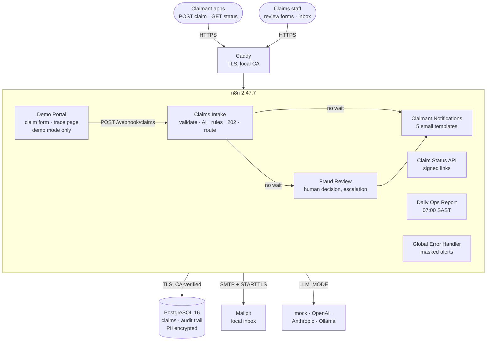
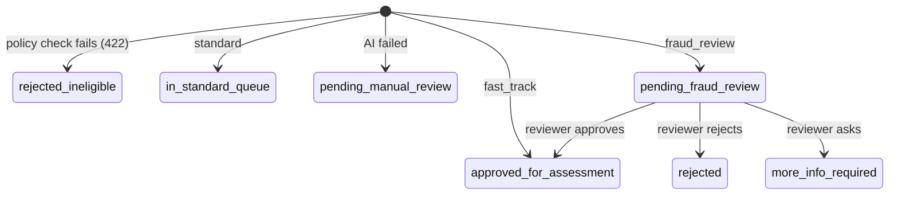

# ClaimFlow

**An AI-assisted insurance claims intake and triage pipeline, built with n8n.**

Claims arrive over an API, are validated against the policy database, analysed by an LLM,
scored by deterministic business rules, stored with a full audit trail, and routed to fast-track,
a standard queue, human fraud review or rejection. Claimants get emails and a status link; the
fraud team gets a decision form; ops gets a daily report and alerts.

`n8n 2.47.7` · `PostgreSQL 16` · `Caddy (TLS)` · `Mailpit` · LLM: `mock` / OpenAI / Anthropic / Ollama
· only Docker needed to run it · 140+ automated end-to-end checks · browser demo mode

> **Acme Cover is fictional.** Every person, policy, email address and phone number in this repo is
> invented. This is a portfolio project, not affiliated with any real insurer.

---

## Why this exists

Claims triage is repetitive, high-volume and sensitive: most claims are routine, a few are
fraudulent, and every decision has to be explainable. ClaimFlow shows how to put an LLM into that
process **without giving it the decision**:

- the LLM reads the free-text description and suggests a type, severity, summary and risk;
- deterministic rules check the facts (policy age, amount vs sum insured, claim history…);
- code decides the route, every step is written to an append-only audit trail, and anything
  risky goes to a human.

## Highlights

- **AI + rules, not AI alone.** The LLM is advisory; routing is deterministic, explainable code with
  `route_reasons` stored for every claim.
- **Human in the loop.** Fraud reviewers get a decision-ready HTML email and an n8n form; no answer
  in 24 h escalates to ops; nothing is ever auto-approved.
- **Respond first, route later.** The caller gets `202 + claim_ref` as soon as the claim is analysed
  and stored (well under a second in mock mode, about 3 s with a local LLM); emails and human
  review happen afterwards.
- **Personal information protected.** Name, email and phone are encrypted per field (AES-256-GCM)
  before they reach the database; TLS on every hop; no PII is sent to the LLM.
- **Layered prompt-injection defence, measured.** An independent detector, a tripwire and
  deterministic routing, red-teamed with a held-out attack set and the results published below,
  including where it falls short.
- **No tipping off.** Claimants never see scores, flags or the word "fraud", in emails or the
  Status API.
- **See it run.** Demo mode adds a claim form and a live **Claim Trace** page: every pipeline step,
  the AI output, each rule flag, the route and the audit trail, updating while a human reviews.
- **Tested end to end.** `./scripts/run-scenarios.sh` resets the data and runs 140 checks over real
  HTTPS (143 with demo mode on), including submitting the fraud-review form and reading emails from Mailpit.

---

## Architecture



### Claim lifecycle



Full data model: [docs/database.md](docs/database.md).

---

## Screenshots

> Placeholders: add PNGs to `docs/screenshots/` with these names.

| | |
|---|---|
|  | **Claims Intake** in the n8n editor |
|  | **Fraud review email**: risk banner, facts, flags, untrusted description |
|  | **Decision form** with the claim summary |
|  | **Daily ops report** |
|  | **Error alert** with masked details |
|  | **`run-scenarios.sh`**: every check passing |
|  | **Claim Trace** page (demo mode) |

---

## Quickstart (about 5 minutes)

**You need:** Docker Desktop (or Docker Engine with Compose v2). Nothing else: secrets,
certificates and deployment all run in containers. For a local LLM on a GPU, an NVIDIA card with
Docker GPU support (optional).

```bash
git clone <this repo> claimflow && cd claimflow
docker compose run --rm init      # first time only
docker compose up -d
```

- **`init`** (a one-shot Alpine container with openssl) creates `.env` from `.env.example` with
  fresh random secrets (never printed) and a local certificate authority + TLS certificates
  (`certs/`, gitignored; the CA key stays in `ca-private/`). Re-running it only fills in what's
  missing.
- **`up -d`** starts Caddy, Postgres, Mailpit and n8n, then the one-shot **`deploy`** service (the
  n8n image): it creates the n8n credentials, encrypts the seed personal information, imports
  the workflows and publishes them in dependency order (the Demo Portal only in demo mode), and
  pulls the Ollama model if you use one. It runs again on every `up -d`, so settings changes and
  workflow edits are applied the same way. Check it with `docker compose logs deploy`.
- Prefer one command? `./scripts/setup.sh` (bash) does the same and adds an HTTPS smoke test.

Then:

1. **Create your n8n owner account** at **https://localhost:8443** (local only; any details).
2. **Trust the local CA** so browsers stop warning. Windows (PowerShell, current user only):
   ```powershell
   certutil -user -addstore Root .certsca.crt
   ```
   macOS: `sudo security add-trusted-cert -d -r trustRoot -k /Library/Keychains/System.keychain certs/ca.crt`.
   Or click through the browser warning.
3. **Try it:** turn on demo mode (next section) to log claims in the browser, or post a sample
   claim with `./scripts/post-sample.sh samples/03-suspicious-theft.json` (needs Node.js 18+).
4. **Open the inbox** at **https://localhost:8025**: the claimant's "received" email and the fraud
   team's review request are there. Click **Review and decide** to make a decision.
5. **Run the tests** (developer tool; needs bash and Node.js 18+, e.g. Git Bash on Windows):
   ```bash
   ./scripts/run-scenarios.sh
   ```

### Try it in a browser (demo mode)

To log claims through a form and watch them move through the pipeline:

1. In `.env` set `CLAIMFLOW_DEMO_MODE=true` and, for a real model, `LLM_MODE=ollama` (or `openai` /
   `anthropic` with a key, plus `COMPOSE_PROFILES=ollama` for Ollama). Then `docker compose up -d`.
2. Log in to n8n at https://localhost:8443, then open **https://localhost:8443/form/claim-demo**.
3. Pick a policy, enter made-up details and submit. The form calls the same `POST /webhook/claims`
   as any client, then opens the **Claim Trace** page: pipeline steps, injection check, AI output
   (model, score, summary, indicators), every rule flag with its points, the score blend, the route
   and why, masked PII next to its ciphertext, and the append-only audit trail.
4. If it went to fraud review, open Mailpit, click **Review and decide**, and watch the trace page
   update (it refreshes every 3 s while anything is pending).
5. **Node by node:** in demo mode the claim workflows keep their successful executions, so n8n's
   **Executions** tab shows every node's input and output for your claim.

Demo mode is for local demos only: the trace page shows internal signals, and kept executions hold
whatever details you typed. With it off (the default), the form and trace page return 404.
The first claim after Ollama has been idle takes up to about 40 s while the model loads; after that,
about 4 s from submit to trace page.

| URL / port | What |
|---|---|
| https://localhost:8443 | n8n editor, webhooks, review forms |
| https://localhost:8025 | Mailpit inbox (every email lands here) |
| https://localhost:8443/form/claim-demo | Demo claim form (demo mode, n8n login) |
| `localhost:5433` | PostgreSQL (TLS required) |

Day to day: `docker compose stop` / `docker compose up -d`. Run the daily report now:
`./scripts/run-report.sh`.

---

## The workflows

### 1. Claims Intake: `POST /webhook/claims`
Validate the payload (all errors at once → **400**) → idempotency check (same key → **200** with the
original `claim_ref`) → policy eligibility (exists, active, in cover, within sum insured; otherwise
stored and **422**) → **encrypt PII** → injection detector + AI analysis (`LLM_MODE`) → normalise and
validate the AI output → deterministic rules and blended score → insert claim + 3 audit events in
one statement → **202** with `claim_ref` and a signed `status_url` → route: notify, start fraud
review. [Design](docs/workflows/01-claims-intake.md)

### 2. Fraud Review (sub-workflow)
Loads the claim **without contact details** (waiting runs are stored), sends the fraud team an HTML
email with a link to an n8n form (decision, reviewer, internal notes, message to claimant), waits.
No answer: an amber escalation to ops with the same form; still none: logged, left pending for the
SLA report. The decision applies only if the claim is still pending (first decision wins), then the
claimant is notified. [Design](docs/workflows/02-03-subworkflows.md)

### 3. Claimant Notifications (sub-workflow)
`claim_ref` + template → decrypt name/email in memory → one of five templates (received, approved
for assessment, rejected ineligible, rejected, more information needed), HTML + text, every value
escaped → SMTP (STARTTLS) → audit event with a **masked** address.

### 4. Claim Status API: `GET /webhook/claims/status?ref=…&t=…`
`t` is an HMAC of the claim ref, so sequential references can't be enumerated; a wrong or missing
token gets the same 404 as an unknown claim. Internal statuses are mapped to public ones (fraud
review shows as "Under review"). [Design](docs/workflows/04-06-api-report-errors.md)

### 5. Daily Ops Report: 07:00 SAST
One SQL snapshot → HTML email to ops: volumes, routes, **SLA breaches** (open > 48 h), fraud-review
outcomes, top fraud indicators and rule flags, injection flags, AI and system health. No PII.

### 6. Global Error Handler
The error workflow for all the others. Masks emails, SA phone numbers, ID/card numbers and
ciphertext, logs to `workflow_errors`, emails a red alert with a link to the failed execution. The
log and the alert each continue on error, so an SMTP outage can't hide a failure.

### 7. Demo Portal (demo mode only)
An n8n **Form Trigger** at `/form/claim-demo`, behind n8n's own login, turns the form into a normal
intake request and posts it to the real webhook, then redirects to `GET /webhook/demo/trace`: an
internal Claim Trace page behind a signed link (a different HMAC from status links, so a
claimant's link can't open it). [Design](docs/workflows/07-demo-portal.md)

---

## Design decisions

**Why AI + rules rather than AI alone?** The LLM is good at reading messy free text, but it isn't
deterministic, can be manipulated, and can't explain itself to an auditor or an ombud. Rules are
explainable and stable but can't read. ClaimFlow blends them (`0.6 × AI + 0.4 × rules`), stores
every rule flag with its reason, and lets **code** pick the route. Testing showed why this matters:
a real local model scored four of five injected claims at risk 0, and the rules still sent them to a
human.

**Why respond before routing?** The caller needs a reference immediately; fraud review can take a
day. So intake stores the claim and its audit events, returns **202**, and only then sends emails
and starts the review (sub-workflows called without waiting). An email outage never blocks intake.

**Why idempotency?** Mobile apps and WhatsApp bots retry. Each request carries an
`idempotency_key`; a duplicate returns the original `claim_ref` (**200**), and a `UNIQUE` constraint
with `ON CONFLICT DO NOTHING` covers two requests racing (**409**, retry).

**Why human in the loop?** A suspicious claim is a judgement call with legal consequences. The model
and rules prioritise the work; a person decides. Reviewers see the system's reasoning (route reasons,
flags with points) before the evidence, the claimant's text is marked untrusted, and the first
decision wins.

**Fail safe.** AI failure → `manual_review`. Injection detector unavailable → no fast-track. Any
injection signal → fraud review, even if the AI failed. Nothing is auto-approved on timeout.

**No tipping off.** Claimants never see scores, flags or fraud wording, in emails or the Status API.

**Data minimisation (POPIA-minded).** The LLM gets claim facts only, never name, email, phone or
policy number. The fraud-review run, stored while it waits, holds no contact details. Successful
runs of PII workflows don't keep their data (unless demo mode is on).

---

## Security

| | |
|---|---|
| In transit | Caddy TLS for the editor, webhooks and inbox; Postgres **rejects non-TLS** connections and n8n verifies its certificate; Mailpit **requires STARTTLS** |
| At rest | Name, email, phone encrypted per field (AES-256-GCM, field-bound, versioned key); email HMAC blind index for lookups; database types reject plaintext |
| Links | Status links HMAC-signed; review form links signed and single-use (n8n) |
| Logs | Errors masked before storage or email; successful PII runs keep no execution data (purged within ~5 min) |
| Demo mode | Off by default; the form needs an n8n login, the trace page a signed link; both 404 when off |
| Secrets | Generated by the `init` container into a gitignored `.env`; credentials created by the `deploy` container |

Details, keys and rotation: [docs/security.md](docs/security.md).

---

## Testing and measured results

```bash
./scripts/run-scenarios.sh            # 13 scenarios + 12 flow checks, mock mode
./scripts/run-scenarios.sh --redteam  # held-out injection set, any LLM_MODE
```

The suite resets the claim data to the seed state, then checks HTTP codes, routes, rule flags, the
audit trail, every email (via Mailpit's API), the Status API, all three fraud-review decisions
submitted through the real form, double-submit protection, no tipping off, that a database dump
contains no sample PII, the daily report, demo mode (on: trace page, login-gated form, kept runs;
off: everything 404, no runs kept), and that no workflow errors were logged.

**Result: 140/140 checks with demo mode off, 143/143 with it on, about 27 seconds.** Its first runs caught two real bugs.
Details: [docs/testing.md](docs/testing.md).

### Prompt-injection red-team (honest numbers)

| Set | Model | Caught | False alarms |
|---|---|---|---|
| Tuning set, full pipeline (5 attacks, 4 benign) | llama3.2:3b, RTX 4050 | 4/5 | 0/4 |
| **Held-out set** (8 unseen attacks, 4 benign) | llama3.2:3b, RTX 4050 | **1/8** | 1/4 |
| Held-out set | mock (regex + keyword stub) | 1/8 | 0/4 |

The detector prompt **overfitted** its tuning set; on unseen attacks a 3B local model detects
almost nothing, and one politely paraphrased attack on a small claim was fast-tracked (approved for
*assessment*, not paid, capped at R20 000). Most attacks still reached a human because other rules
fired. The fix is a stronger detector or a dedicated classifier, measured with the same harness
before going live. See [docs/testing.md](docs/testing.md) and
[docs/workflows/01-claims-intake.md](docs/workflows/01-claims-intake.md).

---

## Configuration

All settings live in `.env` (documented in [.env.example](.env.example)). Most useful:

| Variable | Default | |
|---|---|---|
| `LLM_MODE` | `mock` | `mock` (deterministic, no key), `openai`, `anthropic`, `ollama` |
| `OPENAI_MODEL` / `ANTHROPIC_MODEL` / `OLLAMA_MODEL` | `gpt-6-luna` / `claude-haiku-5-5` / `llama3.2:3b` | Model per provider |
| `OPENAI_API_KEY` / `ANTHROPIC_API_KEY` | empty | `docker compose up -d` after adding one |
| `CLAIMFLOW_REVIEW_TIMEOUT_MINUTES` | `1440` | Fraud review escalates after this |
| `CLAIMFLOW_SLA_HOURS` | `48` | Daily report SLA threshold |
| `CLAIMFLOW_DEMO_MODE` | `false` | Claim form + trace page, keeps executions |
| `COMPOSE_PROFILES` | empty | `ollama` to start the local LLM |

After changing `.env`: `docker compose up -d` (re-creates n8n and re-runs deploy).

**Local LLM on a GPU:** set `LLM_MODE=ollama` and `COMPOSE_PROFILES=ollama`, then
`docker compose up -d`; Ollama starts and the deploy service pulls the model. llama3.2:3b on an RTX 4050 runs fully on the GPU at about 3 s per claim (detector +
analysis).

**Cost (hosted):** about 1,100 input + 150 output tokens per analysis. At gpt-6-luna list prices
(checked 2026-11-15, $0.10 / $0.50 per 1M tokens) that's about **$0.19 per 1,000 claims**, roughly
double with the injection detector's extra call. Tests run in mock mode and cost nothing.

---

## Repo structure

```
├── docker-compose.yml          Caddy, n8n, Postgres, Mailpit, optional Ollama (GPU)
├── .env.example                every setting, documented
├── caddy/Caddyfile             TLS termination
├── db/                         init script (TLS-only), schema.sql, seed.sql
├── workflows/                  the seven n8n workflows (JSON, fixed IDs)
├── scripts/
│   ├── init.sh                 first-run secrets + certificates (runs in the init container)
│   ├── deploy.js               credentials, seed PII, workflows (runs in the deploy container)
│   ├── setup.sh                optional one-command wrapper: init + up + smoke test
│   ├── run-scenarios.sh/.mjs   end-to-end tests + red-team mode
│   ├── reset-data.sh           back to seed data
│   ├── post-sample.sh          post one sample claim
│   ├── run-report.sh           daily report now
│   ├── eval-injection.js       quick detector comparison against Ollama
│   ├── encrypt-seed-pii.js     encrypts seed PI at setup
│   └── lib/                    pii-crypto, links, internal-email, make-credentials
├── samples/                    13 scenarios + expectations + held-out red-team set
└── docs/                       database, security, testing, per-workflow designs, CV
```

---

## Production next steps

- **Scale:** n8n queue mode with Redis and workers; task runners in external mode; managed Postgres
  17+ (Azure Database for PostgreSQL) with storage encryption and backups.
- **Channels:** WhatsApp intake (Meta Cloud API) feeding the same webhook; voice-bot transcripts
  likewise.
- **AI:** Azure OpenAI in-region; confidence-based escalation (cheap model first, reasoning model
  for grey-zone claims, already designed); a **dedicated injection classifier** proven on the
  red-team harness.
- **Documents:** OCR for photos, quotes and police reports (Azure AI Document Intelligence) feeding
  the rules (for example, amount on the quote vs amount claimed).
- **Systems of record:** Salesforce case sync (MuleSoft or n8n's Salesforce node) so handlers work
  in their CRM, with ClaimFlow's audit trail attached.
- **Reliability:** a transactional outbox with retries for emails (today an SMTP outage loses that
  email: it's logged and alerted, not retried).
- **Security:** review forms behind SSO with reviewer identity from the login; keys in Azure Key
  Vault via managed identity; key rotation job (the `v1:` key version is already in the format).
- **Observability:** execution metrics and alerts (Azure Monitor / Grafana) alongside the daily report.

## Known limitations

- The local 3B model is a weak injection detector on unseen attacks (see results).
- Review links are signed and single-use but still bearer links; reviewer email is self-declared.
- Claimant emails aren't retried after an SMTP failure.
- Single n8n instance; Postgres 16 runs in n8n's "compatibility support" range.
- Claim descriptions are stored in plaintext (they're free text and may contain personal details;
  encrypting them would also need search and review tooling to change).

## Docs

[Database](docs/database.md) · [Security](docs/security.md) · [Testing](docs/testing.md) ·
[Intake design](docs/workflows/01-claims-intake.md) ·
[Fraud review + notifications](docs/workflows/02-03-subworkflows.md) ·
[Status API, report, errors](docs/workflows/04-06-api-report-errors.md) · [CV notes](docs/CV.md)
