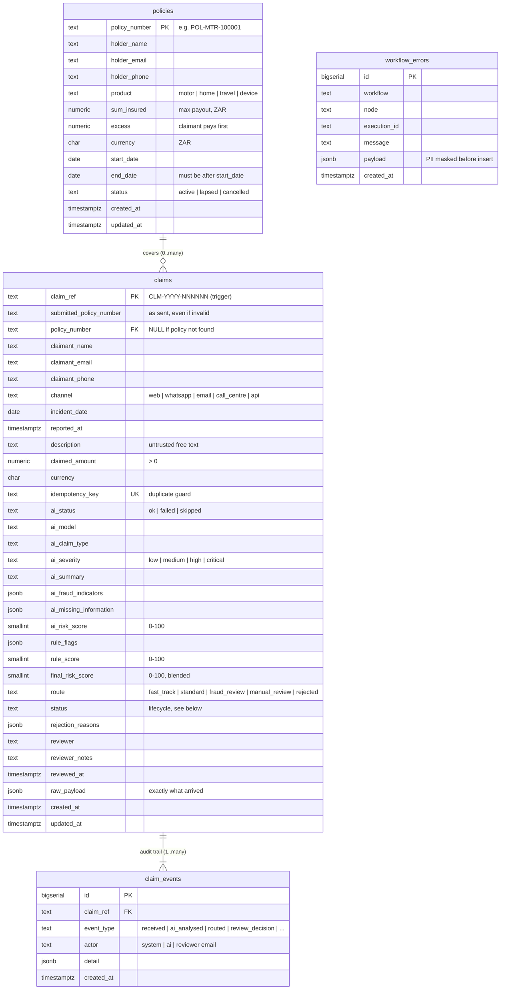
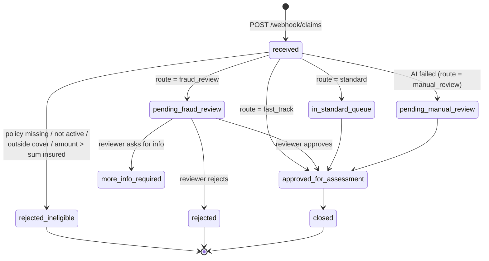

# ClaimFlow database (`claimflow`)

Source of truth: [`db/schema.sql`](../db/schema.sql) · seed data: [`db/seed.sql`](../db/seed.sql)

## Entity relationship diagram

`workflow_errors` is intentionally standalone: an error may happen before a claim exists.

## How the tables are used by the workflows

| Table | Read by | Written by |
|---|---|---|
| `policies` | Intake (eligibility), Daily Report | seed only |
| `claims` | Intake (idempotency, prior claims), Fraud Review, Daily Report | Intake, Fraud Review |
| `claim_events` | Status API (via view), Daily Report | every workflow that changes a claim |
| `workflow_errors` | ops / debugging | Global Error Handler |
| `claim_status_public` (view) | Status API only | n/a, it's a view |

## Claim status lifecycle

## Database-level safeguards

| Safeguard | How | Why |
|---|---|---|
| Unique claim references | `claim_ref_seq` + `claims_set_claim_ref` trigger | Only the DB hands out numbers, so no collisions under concurrency |
| No duplicate claims | `UNIQUE (idempotency_key)` | Last line of defence if two identical requests race |
| Tamper-proof audit trail | `claim_events_append_only` trigger blocks UPDATE/DELETE | History can't be rewritten |
| Valid values only | `CHECK` constraints (product, status, route, scores 0–100, amount > 0) | Bad data is rejected at the door |
| No score leakage | `claim_status_public` view has no risk/fraud/reviewer columns | Public API can't expose internals |
| Auto timestamps | `set_updated_at()` trigger | `updated_at` is always correct |
