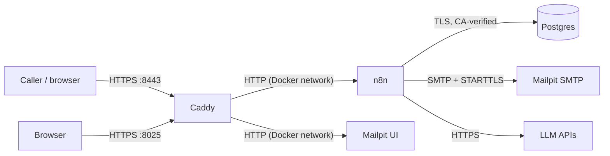

# Security: encryption in transit and at rest

ClaimFlow handles personal information (PI) about claimants: names, email addresses and
phone numbers. This page describes how that data is protected.

## Where PI can live, and how each place is covered

| Location | Protection |
|---|---|
| Caller → n8n (webhooks, editor) | **TLS** via the Caddy reverse proxy |
| n8n → Postgres | **TLS required** (`hostssl` only); n8n verifies the server certificate against the local CA |
| n8n → Mailpit (SMTP) | **STARTTLS required** |
| n8n → OpenAI / Anthropic | HTTPS (provider); **no PI is ever sent** (prompt contains claim facts only) |
| `claims` / `policies` tables | Name, email, phone **encrypted per field** (AES-256-GCM); email also stored as an HMAC blind index |
| `claims.raw_payload` | Stored with PI fields replaced by `"[encrypted]"` |
| n8n execution history | Successful runs of PI workflows store **no data**; failed runs are kept 7 days for debugging |
| `workflow_errors` | Email and phone patterns masked before insert |
| Mailpit inbox | Inherent: an email to a claimant contains their address. In production this is a real mail provider |
| Disk / volumes | Local: your OS disk encryption (e.g. BitLocker). Production: Azure Database for PostgreSQL encrypts storage with AES-256 by default (optionally customer-managed keys in Key Vault) |

## Encryption in transit

- **One local certificate authority.** the one-shot `init` container
  (`scripts/init.sh`, pinned Alpine + openssl) creates `certs/ca.crt` and issues
  certificates for `localhost` (Caddy), `postgres` and `mailpit`. `certs/` is gitignored.
  Trust `certs/ca.crt` once and every local HTTPS page stops warning.
- **TLS terminates at the proxy**, as it would at Azure Application Gateway or Front Door in
  production. n8n itself stays plain HTTP and is no longer published on a host port.
- **Postgres rejects unencrypted TCP connections** (`pg_hba.conf` uses `hostssl` only).
  The `ClaimFlow DB` credential uses `ssl: require` with the CA certificate, so n8n checks
  it is talking to the real server, not only that the connection is encrypted.
- **n8n trusts the local CA** via `NODE_EXTRA_CA_CERTS`, so SMTP STARTTLS to Mailpit is
  verified too.

## Encryption at rest: field-level PI encryption

### What is encrypted

| Table | Encrypted columns | Blind index |
|---|---|---|
| `claims` | `claimant_name_enc`, `claimant_email_enc`, `claimant_phone_enc` | `claimant_email_hmac` |
| `policies` | `holder_name_enc`, `holder_email_enc`, `holder_phone_enc` | `holder_email_hmac` |

Policy numbers and claim references stay readable. The business searches by them, and they
don't identify a person on their own.

### How

- **Application-level, in n8n** (`Encrypt_PII_Func`). Postgres only ever receives ciphertext,
  so the database, its backups and anyone with DB access see no PI.
- **AES-256-GCM** (authenticated encryption): a tampered ciphertext fails to decrypt rather than
  decrypting to garbage.
- **Format:** `v1:<iv>:<auth tag>:<ciphertext>` (base64 parts). `v1` names the key version.
- **Associated data** binds each value to its field (`name`, `email`, `phone`), so a ciphertext
  copied into a different column won't decrypt.
- **Blind index:** `HMAC-SHA256(lower(trim(email)))` with a **separate** key. Equal emails give
  equal hashes, so "find claims from this address" works without decrypting anything, and the
  hash can't be reversed without the key.
- **Decryption happens only where it's needed:** the Claimant Notifications sub-workflow, to
  address an email.

### Keys

| Variable | Purpose |
|---|---|
| `CLAIMFLOW_PII_KEY` | 32-byte AES key (base64), key version `v1` |
| `CLAIMFLOW_PII_HMAC_KEY` | 32-byte HMAC key (base64) for the blind index |
| `N8N_ENCRYPTION_KEY` | n8n's own key for stored credentials (separate on purpose) |

- The `init` container generates them into `.env` if they're missing. Losing `CLAIMFLOW_PII_KEY` means
  the stored PI can't be decrypted. Back it up like a password.
- **Production:** keys come from Azure Key Vault (managed identity), never from a file.
- **Rotation:** add a `v2` key, encrypt new data with it, re-encrypt old rows in a batch job,
  then retire `v1`. The version prefix makes this possible without guessing which key a value
  used.
- **Known limitation:** any Code node can read `$env`, so anyone who can edit workflows can reach
  the key. In production, restrict editor access and fetch the key from Key Vault at runtime.

### Seed data
`seed.sql` can't encrypt (it doesn't know the per-install key), so it writes seed PI to a
temporary `seed_pii` table. The `deploy` container encrypts it into the real columns with the same code the
workflow uses, then **drops** `seed_pii`.

## n8n execution history

n8n stores every item of every run in its own database for debugging, decrypted PI included.
For the PI workflows (Intake, Fraud Review, Notifications):

| Setting | Value |
|---|---|
| Save data of successful production runs | **No** (`saveDataSuccessExecution: none`) |
| Save data of failed runs | Yes |
| Retention of saved runs | **7 days** (`EXECUTIONS_DATA_MAX_AGE=168`) |
| Hard-delete cycle | **every 5 minutes** (`EXECUTIONS_DATA_PRUNE_HARD_DELETE_INTERVAL=5`, default 15) |
| Manual (editor) runs | Saved, for learning and debugging; they use test data only |

**What "don't save" actually means in n8n 2.x** (verified against 2.47.7, not assumed):
node outputs (`runData`) are not stored, but the run's **start data**, the raw webhook
request including the claimant's details, is written first and then **soft-deleted** the moment
the run succeeds. n8n's pruning job removes soft-deleted runs for good on its next cycle, so
plaintext PI from a successful run lives in n8n's database for **at most about 5 minutes**.
Failed runs keep their full data for 7 days so they can be debugged; treat n8n's database as
sensitive (encrypted storage, restricted access) in production.

The audit trail in `claim_events` (no PI) is the system of record, not n8n's history.

## Demo mode (`CLAIMFLOW_DEMO_MODE=true`, local demos only)

Demo mode deliberately relaxes two things so the pipeline can be watched, and it is **off by
default**:

| What changes | Why it's acceptable locally | Guard |
|---|---|---|
| The `deploy` container imports Intake, Fraud Review and Notifications with `saveDataSuccessExecution: all`, so successful runs keep every node's input/output (including what was typed in the form) for 7 days | Only invented test data goes in; it's how you click through a run node by node | Off → setup imports the normal JSON again (verified by test F11) |
| The **Claim Trace** page shows internal signals (scores, flags, route reasons, reviewer notes) | It's an internal view, like the fraud-review email | Signed link `HMAC("trace:"+ref)`, separate from status links; 404 unless demo mode is on; PI shown **masked** only |
| A claim **form** at `/form/claim-demo` | Lets anyone at the keyboard try it | Requires an **n8n login** (Form Trigger "n8n User Auth"); unpublished when demo mode is off |

The form posts to the intake webhook over the container's loopback (`http://127.0.0.1:5678`), so
that one hop never leaves the n8n container. Every other hop is unchanged.
Never enable demo mode on a shared or production instance.
