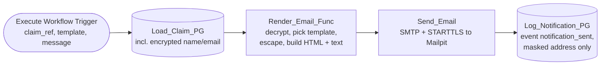
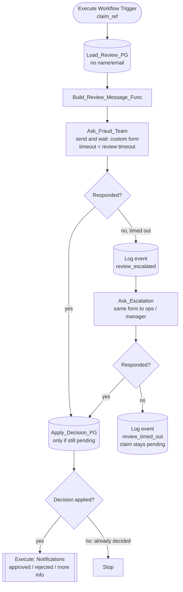

# Workflows 2 and 3: Fraud Review and Claimant Notifications (design)

Both are **sub-workflows**: they start with an *Execute Workflow Trigger* and are called by other
workflows with *Execute Workflow*, like functions. Intake calls them **after** it has sent the
202, with *Wait for sub-workflow completion* **off**, so a fraud review that takes a day never
holds up the claimant's HTTP request.

Nodes verified in n8n 2.47.7: Execute Workflow Trigger v1.3, Execute Workflow v1.4,
Send Email v2.1 (`send` and `sendAndWait`), Postgres v2.8, Code v2, IF v2.4.

## How intake calls them (replaces the Chunk D placeholders)

| Intake outcome | Calls |
|---|---|
| `fast_track` | Notifications (`approved_for_assessment`) |
| `standard`, `manual_review` | Notifications (`received`) |
| `fraud_review` | Fraud Review, then Notifications (`received`) |
| 422 ineligible | Notifications (`rejected_ineligible`) |

Only `claim_ref` (plus a template name) is passed. Each sub-workflow loads what it needs from the
database, so no personal information travels between workflows.

---

## Workflow 3: Claimant Notifications

**Inputs:** `claim_ref` (string), `template` (string), `message` (string, optional: the
reviewer's message to the claimant for `more_info_required`).

| Template | Sent when | Says |
|---|---|---|
| `received` | standard, manual review, fraud review | We've received claim CLM-…; what happens next; status link |
| `approved_for_assessment` | fast track, or reviewer approves | An assessor will contact you; documents to have ready |
| `rejected_ineligible` | policy check failed (422) | Plain-language reasons, e.g. "your policy was not active on the incident date"; how to query it |
| `rejected` | reviewer rejects | We can't proceed; how to request a review; **no reason that reveals fraud checks** |
| `more_info_required` | reviewer asks for more info | The reviewer's message to the claimant; how to reply |

Rules for every email:
- **No tipping off.** Claimants never see risk scores, fraud indicators, rule flags or the word
  "fraud". A rejection after review uses neutral wording. Telling a suspect they're under
  investigation is a real compliance problem for insurers.
- **Decrypt in memory only.** `Render_Email_Func` decrypts name and email with the shared
  `pii-crypto.js` code. Successful runs of this workflow save no execution data (as with intake).
- **Escape everything** inserted into the HTML (names, messages) to prevent HTML injection.
- **Audit without PI:** the `notification_sent` event records the template and a **masked**
  address (`t*****@example.com`), never the full address.
- HTML + plain-text versions, inline CSS (email clients ignore stylesheets), Acme Cover
  branding, the claim reference and the status link.

---

## Workflow 2: Fraud Review (human-in-the-loop)

### The review email and form
The email (to `CLAIMFLOW_FRAUD_TEAM_EMAIL`) contains **what a reviewer needs, and no contact
details**: claim reference, product, policy age, amount vs sum insured, incident and reported
dates, the claimant's description, the AI summary, fraud indicators, rule flags with their
reasons, the final score and the `route_reasons`. The reviewer clicks **Respond** and gets an
n8n-hosted form:

| Field | Type | Required |
|---|---|---|
| Decision | dropdown: Approve for assessment / Reject / Request more information | yes |
| Reviewer email | email | yes |
| Internal notes (not shown to the claimant) | textarea | yes |
| Message to claimant (used for "more information") | textarea | no |

### Applying the decision
One statement updates the claim **only if it is still `pending_fraud_review`**, sets `status`,
`reviewer`, `reviewer_notes`, `reviewed_at`, and appends a `review_decision` event (decision,
reviewer, round). If nothing was updated (a second click, or the escalation and the original
reviewer both answer), the workflow stops: **the first decision wins** and the claimant gets
one email.

| Decision | Status | Claimant email |
|---|---|---|
| Approve for assessment | `approved_for_assessment` | `approved_for_assessment` |
| Reject | `rejected` | `rejected` (neutral wording) |
| Request more information | `more_info_required` | `more_info_required` with the reviewer's message |

### Timeout and escalation
- The wait limit comes from **`CLAIMFLOW_REVIEW_TIMEOUT_MINUTES`** (default 1440 = 24 h). This
  **replaces** `CLAIMFLOW_REVIEW_TIMEOUT_HOURS`: minutes let the tests use a 1–2 minute timeout.
- First timeout: log `review_escalated`, then send the same form to `CLAIMFLOW_OPS_EMAIL`
  (the escalation contact), with the same limit.
- Second timeout: log `review_timed_out`. The claim **stays** `pending_fraud_review`, and the
  Daily Ops Report (Stage 5) lists it as an SLA breach. Nothing is auto-approved.
- **To verify during the build, not assumed:** what send-and-wait outputs when the limit is
  reached. Expected: the run continues with no form answer attached, which `Responded?`
  detects. This will be tested with a 1-minute timeout.

### Security and privacy notes
- **Waiting runs are stored.** While it waits, n8n keeps this workflow's execution in its
  database (up to 2 × the timeout). That's why it loads **no name or email**: data minimisation
  matters most exactly where data has to be persisted.
- **Approval links (verified in the build):** n8n 2.x adds an HMAC `signature` to every
  `/webhook-waiting/...` link, so a guessed or altered URL is rejected, and the link is
  **single-use**: a second submission returned 404. They are still *bearer* links, though:
  whoever holds the email can submit the form, and the reviewer's email is self-declared.
  Production: put the form path behind SSO (or restrict `/webhook-waiting/*` to the internal
  network at the proxy) and take reviewer identity from the login, not a form field.
- Links use `WEBHOOK_URL`, so they're HTTPS through Caddy.

### Testing (Stage 6)
The scenario runner can approve or reject automatically: read the email from **Mailpit's API**,
extract the form link, submit the form, then assert the claim's status, the audit events and
the claimant email.

---

## Build notes (n8n 2.47.7, verified)

- **Publish order matters.** n8n refuses to publish a workflow that calls an unpublished
  sub-workflow. `setup.sh` imports everything first, then publishes in passes until all are live
  (Notifications, then Fraud Review, then Intake).
- **Form fields** are submitted as `field-0` … `field-3` in the order defined; the answers arrive
  on the resumed item keyed by field label. `Read_Response_Func` accepts either shape and
  treats "no Decision" as a timeout.
- **The review email's message** is rendered with `white-space: pre-line`, so line breaks survive
  in the HTML version.
- Successful fraud-review runs are soft-deleted when they finish (`saveDataSuccessExecution: none`);
  only *waiting* runs are stored, and they hold no claimant contact details.

## Shared: SMTP credential
`ClaimFlow SMTP`, created by `setup.sh` like the others: host `mailpit`, port 1025,
`secure: false` with STARTTLS (Mailpit requires it), certificate trusted through
`NODE_EXTRA_CA_CERTS`. Production: a real provider (for example Azure Communication Services or
Microsoft 365) with SPF/DKIM.
