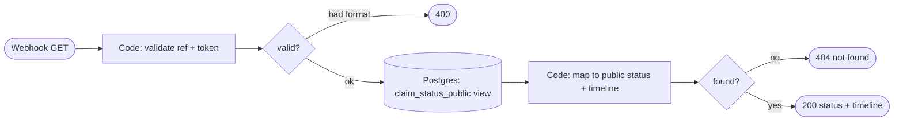
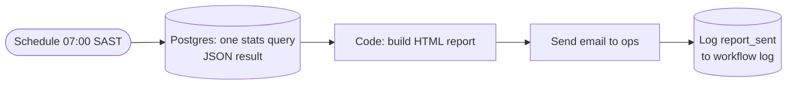
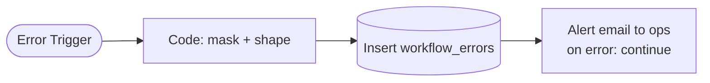

# Workflows 4–6: Claim Status API, Daily Ops Report, Global Error Handler (design)

Nodes verified in n8n 2.47.7: Webhook v2.2 (GET), Schedule Trigger v1.4, Error Trigger v1,
Postgres v2.8, Code v2, IF v2.4, Respond to Webhook v1.5, Send Email v2.1.

---

## Workflow 4: Claim Status API

`GET /webhook/claims/status?ref=CLM-2026-000123&t=<token>`



### Decision: stop people enumerating claims (recommended: signed link token)
Claim references are **sequential** (`CLM-2026-000035`, `…036`), so a `ref`-only API lets anyone
walk through every claim and learn its product, dates and status. Options:

| Option | How | Trade-off |
|---|---|---|
| **A. Signed link token (recommended)** | `t = HMAC-SHA256(CLAIMFLOW_STATUS_LINK_KEY, claim_ref)`, first 32 hex chars. Every status link we hand out (202 response, emails) includes it | Can't be guessed; no extra input for the claimant; same pattern as n8n's signed approval links. New secret, generated by `setup.sh` |
| B. Ref + policy number | Caller must also send the policy number | Still guessable once someone knows a policy number |
| C. Ref only (as in the original spec) | – | Enumerable. Acceptable only because no PI is returned |

With **A**, a wrong or missing token gets **exactly the same 404** as an unknown claim, so the
API never confirms that a reference exists. The token is compared in constant time.

### Response (no internal data)

```json
{
  "claim_ref": "CLM-2026-000036",
  "status": "under_review",
  "status_label": "Under review",
  "product": "device",
  "incident_date": "2026-11-15",
  "submitted_at": "2026-11-17T22:31:01+02:00",
  "last_updated": "2026-11-17T22:31:01+02:00",
  "timeline": [
    { "event": "received",      "label": "Claim received",  "at": "2026-11-17T22:31:01+02:00" },
    { "event": "assessed",      "label": "Claim assessed",  "at": "2026-11-17T22:31:01+02:00" },
    { "event": "email_sent",    "label": "We emailed you",  "at": "2026-11-17T22:31:01+02:00" }
  ]
}
```

**No tipping off here either.** Internal statuses are mapped to public ones, so a claim under
fraud review looks exactly like one in the normal queue:

| Internal status | Public status |
|---|---|
| `received` | `received`: Received |
| `in_standard_queue`, `pending_fraud_review`, `pending_manual_review` | `under_review`: Under review |
| `approved_for_assessment` | `approved_for_assessment`: Approved for assessment |
| `more_info_required` | `more_info_required`: More information needed |
| `rejected`, `rejected_ineligible` | `not_accepted`: Not accepted |
| `closed` | `closed`: Closed |

The timeline comes from the `claim_status_public` view, which already excludes AI, escalation
and timeout events. Event names are mapped to neutral labels too. No scores, flags, reviewer
names or notes are ever returned.

| Code | When |
|---|---|
| 200 | Found and token valid |
| 400 | `ref` missing or not shaped like `CLM-YYYY-NNNNNN` |
| 404 | Not found **or** token missing/invalid (same body) |

---

## Workflow 5: Daily Ops Report



- **Schedule:** cron `0 7 * * *`, workflow timezone `Africa/Johannesburg`. If n8n was down at
  07:00, the missed run executes when it comes back (`misfirePolicy: coalesce`).
- **Window:** the last 24 hours, plus the current backlog.
- **One SQL query** returns everything as JSON (one round trip, consistent snapshot):

| Section | Contents |
|---|---|
| Headline | Claims received (24 h), accepted vs rejected-ineligible, total claimed (R), average final risk |
| By route / status | Counts per route and per current status |
| **SLA breaches** | Open claims (standard queue, manual review, fraud review, more info) older than `CLAIMFLOW_SLA_HOURS` (default 48): claim ref, status, age in hours |
| Fraud review | Decisions in 24 h (approve/reject/more info), escalations, timeouts, still pending |
| Top fraud indicators | AI indicators and rule flags (24 h), most frequent first |
| Injection defence | Claims with injection hard flags, detector unavailable count |
| AI health | AI failures (manual review), LLM mode/model used |
| System | Notifications sent, workflow errors logged (24 h) |

- **No PI:** aggregates and claim references only. Sent to `CLAIMFLOW_OPS_EMAIL`, HTML with
  inline styles, plus a plain-text version.
- **Run on demand** (testing, or a re-send): `scripts/run-report.sh`, which uses
  `n8n execute`. For that, the workflow also has a Manual Trigger feeding the same nodes.

---

## Workflow 6: Global Error Handler



- **Set as the error workflow** (`settings.errorWorkflow`) for **all five** other workflows.
  n8n won't run it for its own failures, which prevents loops.
- **What it receives** (verified): workflow id/name, execution id + editor link, failing node,
  error message, description and stack, and mode. **No item data**, but error descriptions
  can contain SQL with values, so everything is masked.
- **Masking** (`Mask_Error_Func`), applied to message, description and stack before storing
  or emailing:

| Pattern | Example | Becomes |
|---|---|---|
| Email | `thandi.mokoena@example.com` | `t***@example.com` |
| SA phone | `+27 82 555 0101`, `082 555 0101` | `+27 *** ***0101` |
| SA ID number (13 digits) | `8001015009087` | `[id-number]` |
| Card-like number (13–19 digits) | `4111 1111 1111 1111` | `[card-number]` |
| Our ciphertext | `v1:…:…:…` | `[ciphertext]` |

  Long fields are truncated (stack to 2,000 characters).
- **Store:** `workflow_errors(workflow, node, execution_id, message, payload)`, where `payload`
  holds `{ workflow_id, mode, retry_of, description, stack, execution_url }`, all masked.
- **Alert email** to ops: workflow, node, masked message, a link to the failed execution in
  the editor. The email node is set to *continue on error*, so **an SMTP outage can't stop the
  error from being logged** (and the log insert runs first).
- **Testing:** two simulated outages.
  1. **Mailpit down** → claimant email fails after retries → Notifications errors → the handler
     logs it (its own alert email also fails, and is skipped as designed).
  2. **A failing query** in a test-only call → handler logs and emails the alert.

---

## Changes to existing pieces
- **Status links get the token:** the 202, 200-duplicate and 422 responses, and the claimant
  emails' "Check claim status" button.
- **New environment variables:** `CLAIMFLOW_STATUS_LINK_KEY` (generated by `setup.sh`) and
  `CLAIMFLOW_SLA_HOURS=48`.
- **`setup.sh`:** after publishing, sets `errorWorkflow` on every workflow (or it's baked into the
  JSON, which is simpler; fixed IDs make that possible).
- **Fixed workflow IDs:** `cfStatusApi00001`, `cfDailyReport001`, `cfErrorHandler01`.
